<h1 align="center">local-ai-reels</h1>

<p align="center"><b>Topic → finished 1080×1920 vertical reel with voice, subtitles, motion graphics and music. Local, no paid APIs.</b></p>

<p align="center">
  <a href="https://github.com/alteralto/local-ai-reels/actions/workflows/ci.yml"></a>
  <a href="https://github.com/alteralto/local-ai-reels/actions/workflows/lint.yml"></a>
  <a href="https://github.com/alteralto/local-ai-reels/actions/workflows/rust.yml"></a>
  <a href="LICENSE"></a>
  
  
</p>

<p align="center"><a href="README.md">Русская версия</a></p>

<p align="center">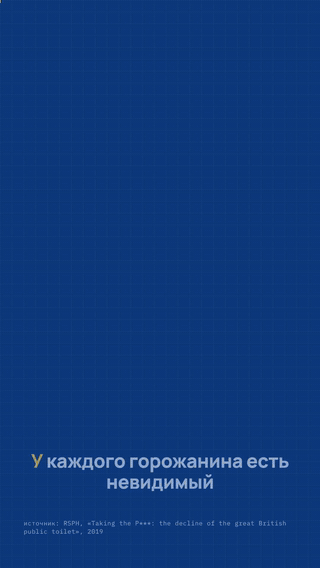</p>

> The project, its templates and its messages are Russian-first today: stress marks (RUAccent), Russian TTS
> weights and Russian CLI output. The pipeline itself is language-agnostic, and English support is on the roadmap.

## Who it is for

<table>
<tr>
<th width="50%">Everyone</th>
<th width="50%">ML engineers</th>
</tr>
<tr>
<td valign="top">

- **Desktop app**: type what the reel is about, pick a look, press "Make reel", get a finished video.
  A local LLM writes the script; the rest runs on its own.
- Installers for Linux, macOS and Windows detect your GPU.
- No command line. A GPU helps but is not required.
- [How to use it → app/desktop](app/desktop/README.md)

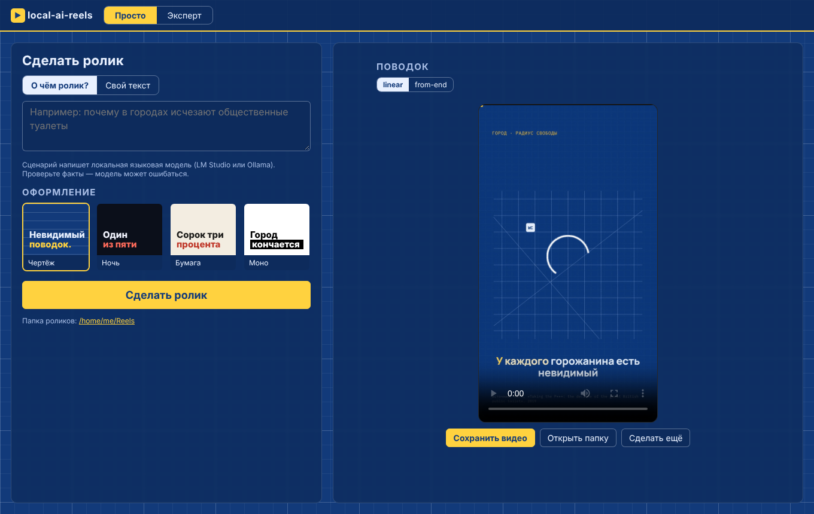

From a terminal it is almost as simple: your own 4 paragraphs → a project with headline scenes:
`python -m reels new my-reel --text text.txt --theme night`.

</td>
<td valign="top">

- CLI and Python package: one `reel.yaml` per project, cached stages with human approval gates.
- Hardware profiles (GPU / Apple / CPU), `reels doctor`, manual device and thread control.
- Swappable models: F5-TTS, Qwen3-TTS, Piper, your own recording; Whisper, MusicGen.
- Rust conveyor `reels-app` for batch throughput, a Docker image, a factory that turns a topic list into reels.
- Machine-readable contract: `status --json`, `doctor --json`, exit codes `0/1/2/3`.

</td>
</tr>
</table>

## Features

- **One narration → many edits.** Blocks are reordered on the timeline (`1234`, `4123`, `1324`); the voice is
  synthesized once.
- **Voice cloning with stress marks.** F5-TTS + RUAccent (`+` marks), Qwen3-TTS for commercial work, Piper for CPU.
- **Whisper verification.** Every take is transcribed and compared to the script; the verbatim one wins.
- **Scene templates anchored to the narrator's words**: `at: "каждый пятый"` starts the animation on those words.
- **Themes**: `blueprint`, `night`, `paper`, `mono` or your own accent color.
- **Automated layout QA** on the DOM of every frame before rendering; duration, loudness and text checks after.
- **Ducked music**: quieter under the voice, louder in pauses and on the end card.
- **Ready to publish**: SRT/VTT subtitles, 9:16 and 4:5 covers, post text with hashtags, a report.
- **Caching and approval gates**: stages only rerun when inputs change; a human approves script, stress marks,
  take and frames — or runs on autopilot with `--yes`.
- **Factory**: a file of topics → local-LLM drafts → reels and a summary.
- **`reels doctor`**: what hardware you have, which profile was picked, what is missing and how to install it.

## Quick start

The example works **without a GPU and without models**: its narration and music are in the repo.

**Linux / macOS**

```bash
git clone https://github.com/alteralto/local-ai-reels && cd local-ai-reels
bash install.sh                 # .venv, PyTorch for your hardware, the package, a check; --help for flags
source .venv/bin/activate
python -m reels run examples/povodok-templates --yes
```

**Windows** (PowerShell)

```powershell
git clone https://github.com/alteralto/local-ai-reels; cd local-ai-reels
powershell -ExecutionPolicy Bypass -File install.ps1
.\.venv\Scripts\Activate.ps1
python -m reels run examples/povodok-templates --yes
```

**Docker** (CPU, pre-made narration):

```bash
docker build -t local-ai-reels . && docker run --rm -v "$PWD:/work" local-ai-reels run examples/povodok-templates --yes
```

Reels land in `examples/povodok-templates/out/` next to `report.md`. You need ffmpeg and Node.js 22+ — the
installer prints the command if they are missing.

<p align="center"></p>

| Example | What it shows |
|---|---|
| [`examples/povodok`](examples/povodok) | port of the original reel with hand-written SVG scenes (`type: custom`) |
| [`examples/povodok-templates`](examples/povodok-templates) | the same text using templates only — no HTML at all |

Three more reels are in [More reels](#more-reels).

## How it works

<p align="center">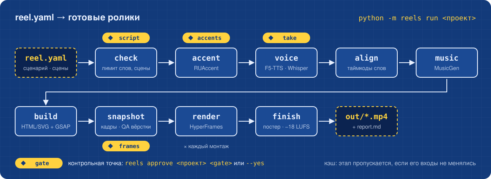</p>

| Stage | What it does | With |
|---|---|---|
| `check` | word limit, blocks, scene params, anchors | — |
| `accent` | stress marks, manual fixes in `voice.accents` | RUAccent |
| `voice` | reference voice, takes, pick by verification | F5-TTS / Qwen3-TTS / Piper / file + faster-whisper |
| `align` | word timings, block boundaries | faster-whisper |
| `music` | background from a prompt, −18 LUFS, ducking | MusicGen / file |
| `build` | a HyperFrames project per edit | HTML/SVG + GSAP |
| `snapshot` | frames before rendering, layout QA, contact sheet | HyperFrames, Chrome |
| `render` | MP4 1080×1920 | HyperFrames |
| `finish` | poster, measurements, audio check, subtitles, covers, post, report | ffmpeg, faster-whisper |

Gates: **script** → **accents** → **take** → **frames**. Approval is bound to the artifact's hash: change the
script and you approve again. Details: [docs/architecture.md](docs/architecture.md) (Russian).

## Speed and hardware

The acceleration profile is picked automatically; see the choice and what is missing with `python -m reels doctor`.

| Profile | When | What happens |
|---|---|---|
| `gpu-max` | NVIDIA with 8 GB+ | everything on the GPU, models stay loaded, NVENC poster |
| `gpu-lowvram` | NVIDIA under 8 GB | models one at a time, Whisper `int8_float16`, 1 music variant |
| `apple` | Apple Silicon | F5 / MusicGen on MPS, Whisper on CPU, VideoToolbox poster |
| `cpu-fast` | no GPU | F5 / Qwen3 → Piper, Whisper `small` int8, MusicGen skipped |
| `cpu-quality` | manual only | everything as designed, on CPU — slow |

Override with `--profile`, `--device cuda:1`, `--threads 8`, `--allow-slow` (or `hardware:` in `reel.yaml`, or
`REELS_PROFILE` / `REELS_DEVICE` / `REELS_THREADS`). Details: [docs/hardware.md](docs/hardware.md) (Russian).

What we know about speed:

- a 24 s edit renders in about 2 minutes on 4 CPU cores, and in about a minute on an RTX 3060 machine (author's measurement);
- in CI the whole example runs on a regular GitHub runner without a GPU in under 3 minutes;
- for a batch, `reels-app run` pipelines reels: while reel A renders on the CPU, reel B is already being voiced on
  the GPU ([app/README.md](app/README.md)).

## Your own reel

```bash
python -m reels new my-reel --from examples/povodok-templates   # scaffold
$EDITOR my-reel/reel.yaml                                       # script, scenes, voice, edits
python -m reels check my-reel                                   # validate before voicing
python -m reels run my-reel                                     # stops at the script gate
python -m reels approve my-reel script                          # approve and continue
python -m reels run my-reel                                     # … accents → take → frames → done
```

```yaml
title: Невидимый поводок
theme: blueprint
source: "источник: RSPH, «Taking the P***», 2019"
blocks:
  - text: У каждого горожанина есть невидимый поводок, и длину ему отмерил город.
    scene: {type: headline, kicker: "город · радиус свободы", lines: ["Невидимый", "*поводок*."]}
  - text: Каждый пятый выходит из дома реже, чем хочет, — боится не найти туалет.
    scene: {type: fraction, total: 5, highlight: 1, value: "*1* из 5", at: "каждый пятый",
            label: "выходит из дома реже, чем хочет"}
  - text: У двоих из пяти есть болезни, при которых туалет нужен часто.
    scene: {type: stat, value: "*43* %", label: "людей с болезнями, требующими частого туалета",
            at: "двоих из пяти"}
  # …
edits: {linear: "1234", from-end: "4123", suspense: "1324"}
voice: {engine: f5, voices: [denis, dmitri]}      # f5 | qwen3 | piper | file
music: {engine: musicgen, duck: true}             # musicgen | file | none
```

`run` flags: `--yes` autopilot, `--edit linear` one edit, `--from voice` / `--only snapshot` / `--until build` —
stages, `--force` ignore the cache, `--qa warn` don't stop on layout findings, `--no-input` never prompt.
State: `python -m reels status my-reel` (or `--json`).

What you get in `my-reel/out/` for each edit:

| File | What |
|---|---|
| `<slug>-<edit>.mp4` | 1080×1920 reel with a poster in the first frame |
| `<slug>-<edit>-frames.jpg` | contact sheet |
| `<slug>-<edit>.srt`, `.vtt` | subtitles, phrased as on screen |
| `<slug>-<edit>-cover.jpg`, `-cover-4x5.jpg` | covers 1080×1920 and 1080×1350 |
| `<slug>-<edit>.txt` | post text: title, narration, source, hashtags |
| `report.md`, `report.json` | measurements, loudness, text check, findings |

## Script from a local LLM

```bash
python -m reels draft "почему в городах исчезают общественные туалеты" -o drafts/toilets --facts facts.md
```

Any OpenAI-compatible server (LM Studio, Ollama; `--url`, `--model` or `REELS_LLM_URL` / `REELS_LLM_MODEL`).
You get a four-block `reel.yaml` (hook → fact → twist → takeaway) built from library templates. Numbers come only
from `--facts`; the draft still waits at the `script` gate. Why models fill templates instead of drawing scenes:
[local-model-test/](local-model-test/README.md).

## Factory

```text
# topics.txt — one topic per line, facts after " | " or indented below
Почему в городе нет туалетов | RSPH, 2019: каждый пятый выходит из дома реже, чем хочет
Как работает светофор
    Первый электрический светофор — Кливленд, 1914.
```

```bash
python -m reels factory topics.txt -o reels/ --yes
```

Each topic gets a draft and a reel; gates and errors don't stop the factory, and a rerun resumes where it left off.
Summary: `reels/factory.md` and `factory.json`. Several finished projects in a row: `python -m reels batch a b c`.

## More reels

<p align="center">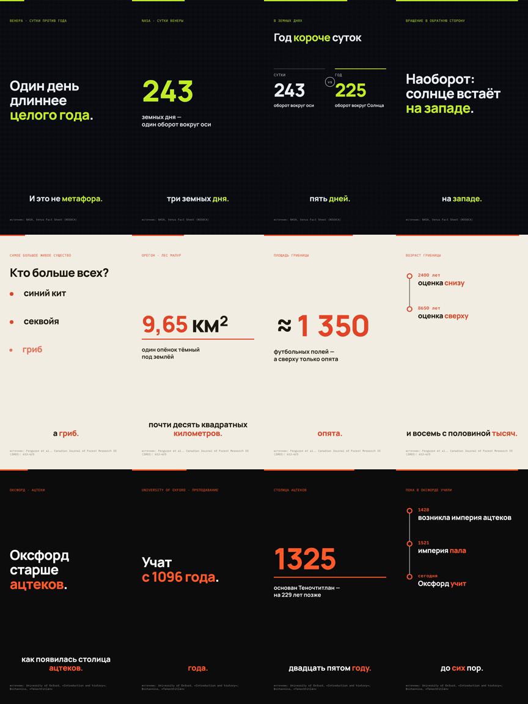</p>

| Example | Theme | About |
|---|---|---|
| [`examples/venera`](examples/venera) | `night` | a day on Venus is longer than its year (NASA) |
| [`examples/opyonok`](examples/opyonok) | `paper` | the largest living organism is an Armillaria fungus in Oregon (Ferguson et al., 2003) |
| [`examples/oxford`](examples/oxford) | `mono` | teaching at Oxford is older than Tenochtitlan |

Templates only, Piper narration on CPU, word timings from Piper's phoneme durations — no Whisper. The narration is
not in the repo (the voice's license is not stated, see [NOTICE.md](NOTICE.md)); voice it yourself with a Piper
voice, preferably CC0 `ru_RU-dmitri-medium` or `ru_RU-denis-medium`:

```bash
python -m reels.align examples/venera --model models/piper/ru_RU-dmitri-medium.onnx
python -m reels run examples/venera --yes
```

<details><summary>The three reels in motion (GIF, no sound)</summary>

<p align="center">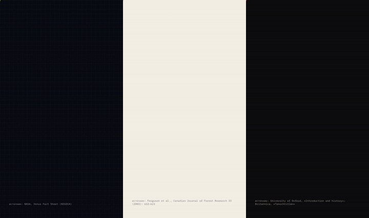</p>

</details>

## Scenes and themes

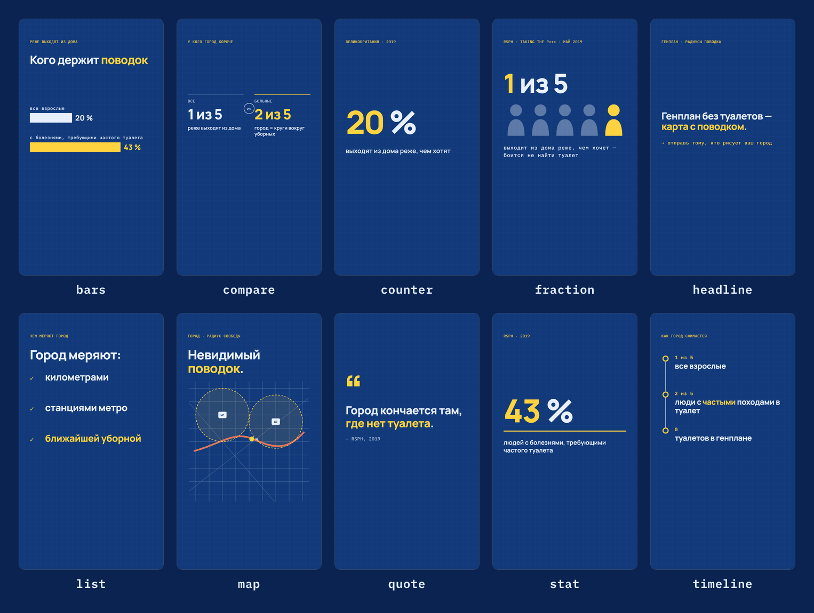

`headline`, `stat`, `fraction`, `bars`, `compare`, `list`, `quote`, `counter`, `timeline`, `map` and `custom` —
your own HTML/SVG/JS scene. Parameters and examples: [docs/scenes.md](docs/scenes.md); in a terminal:
`python -m reels scenes`.

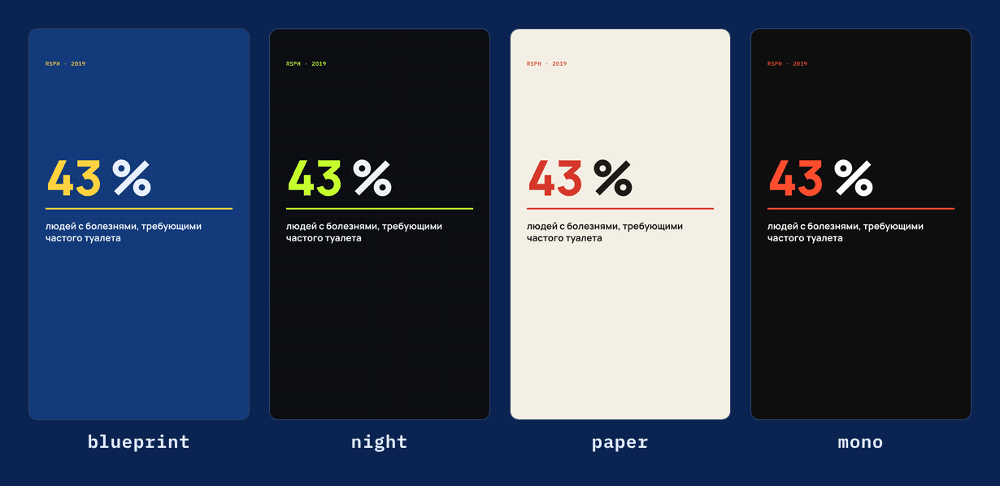

## Many edits from one narration

<p align="center">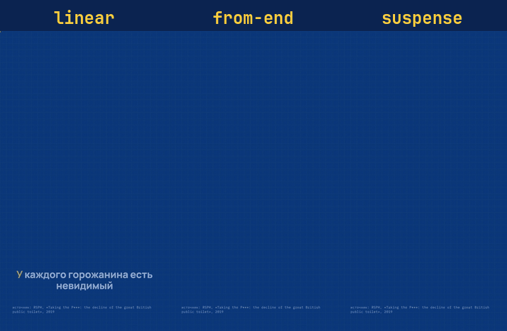</p>

An edit is a block order: `linear: "1234"`, `from-end: "4123"`, `suspense: "1324"`. Slices of the master track
are laid out on the timeline; scenes, subtitles and transitions are recomputed. Three A/B versions — one synthesis.

## Automated QA

<p align="center">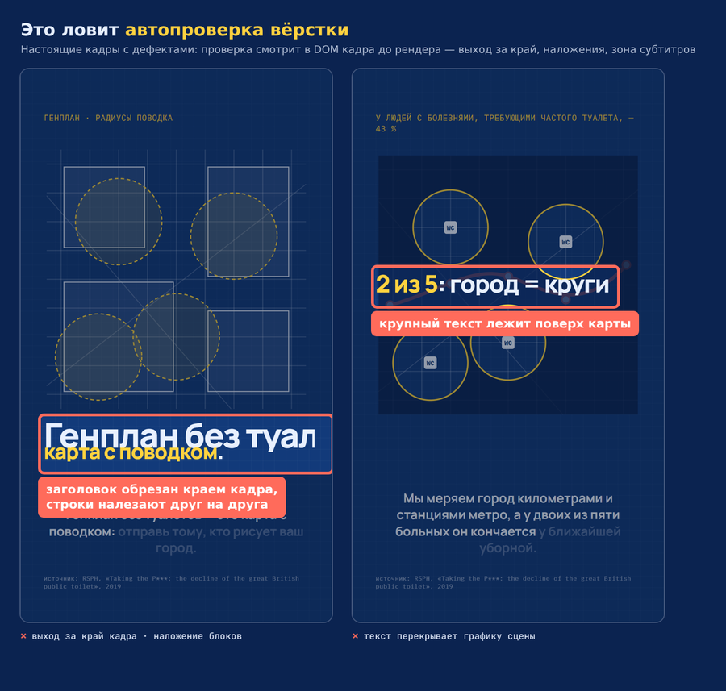</p>

Real defects from [local-model-test/](local-model-test/README.md): local models up to 27B missed them. The
pipeline finds them in the frame's DOM — overflow, overlaps, intrusions into the subtitle zone — and stops at the
`frames` gate. For humans there is a contact sheet:

<p align="center">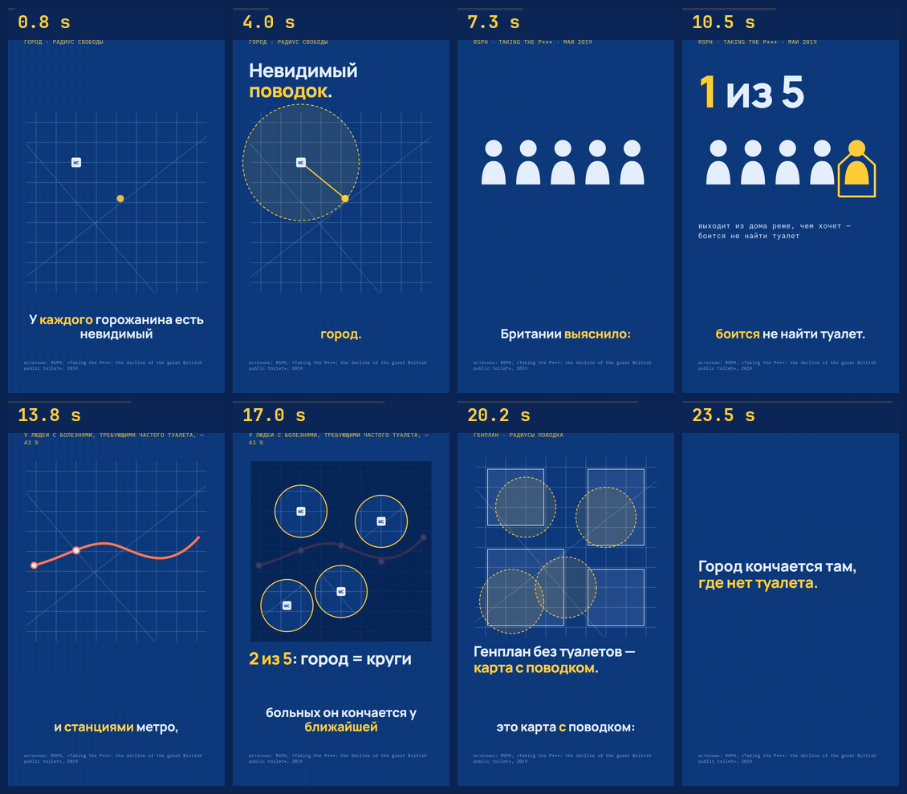</p>

## Apps

| | What | Details |
|---|---|---|
| **Reels Desktop** | Tauri window. "Simple": topic → finished video. "Expert": projects, stages, take picker, frames, log | [app/desktop/README.md](app/desktop/README.md) |
| **reels-app** | Rust conveyor across many projects: `run` (GPU and CPU slots), `status`, `watch` (inbox folder and `topics.txt`), `tui` | [app/README.md](app/README.md) |

| Simple | Expert |
|---|---|
| 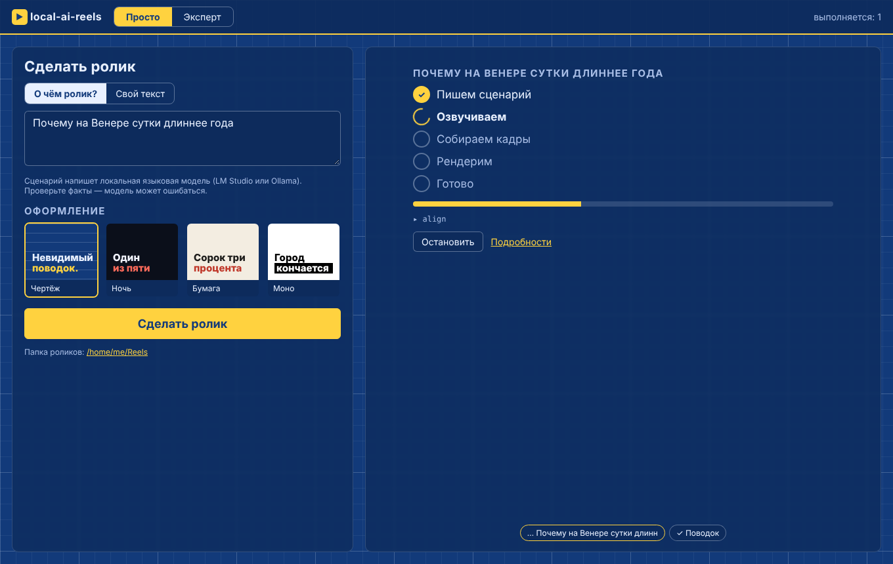 | 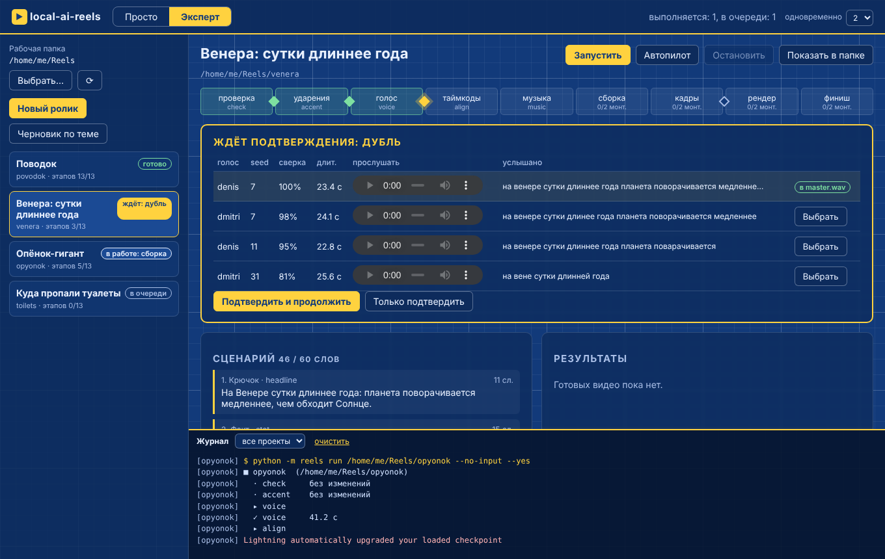 |

Neither app duplicates pipeline logic: both call `python -m reels` and read `status --json`.

## Voices

| Engine | When | GPU | Weights license |
|---|---|---|---|
| `f5` | non-commercial reels, precise stress | required | CC-BY-NC 4.0 |
| `qwen3` | commercial reels, voice cloning | required | Apache-2.0 |
| `piper` | CPU, drafts, reference voices for cloning | not needed | `denis`, `dmitri` — CC0 |
| `file` | your own recording | not needed | yours |

Setup for each: [docs/voices.md](docs/voices.md) (Russian).

## Installation details

- Installers: `bash install.sh [--cpu | --gpu | --full] [--models] [--no-venv]`,
  `install.ps1 [-Cpu | -Gpu | -Full] [-Models] [-NoVenv]`. Without them: `pip install -e .`
  (+ `.[ml]` for F5, RUAccent, Whisper, MusicGen; install PyTorch for your CUDA first).
- Models in one command: `python tools/fetch_models.py` (F5 + Piper; `--whisper --musicgen`, `--dry-run`).
  Hugging Face unreachable — use a mirror: `HF_ENDPOINT=https://<mirror> python tools/fetch_models.py`.
- HyperFrames can't download Chrome (HTTP 403) — point `HYPERFRAMES_BROWSER_PATH` at an installed browser:
  - Windows: `C:/Program Files (x86)/Microsoft/Edge/Application/msedge.exe`
  - macOS: `/Applications/Google Chrome.app/Contents/MacOS/Google Chrome`
  - Linux: `/usr/bin/chromium` or `/usr/bin/google-chrome`
- Profiles, drivers, PyTorch for CUDA and what to install per OS: [docs/hardware.md](docs/hardware.md).

## Manual mode

The pipeline grew out of scripts, and they stay as a step-by-step reference:

- [`scripts/`](scripts) — each stage as a separate command;
- [docs/guide.md](docs/guide.md) — the detailed guide (Russian; also as a [PDF](docs/guide.pdf) with all script code);
- [local-model-test/](local-model-test/README.md) — can small local models handle scenes and frame QA.

## Licenses

Code: Apache-2.0 ([LICENSE](LICENSE)). Models are not in the repo: the Russian F5-TTS weights and MusicGen are
**CC-BY-NC 4.0, non-commercial only**; Qwen3-TTS is Apache-2.0 — use it for commercial work; Piper voices `denis`
and `dmitri` are CC0. Narration and music in `example/` are for non-commercial use only. Details:
[NOTICE.md](NOTICE.md). Clone someone's voice only with their consent.

## Roadmap

- [ ] English and other languages: stress, alignment and subtitles without Russian assumptions
- [ ] Horizontal and square formats from the same `reel.yaml`
- [ ] New templates: line chart, world map, before/after with photos
- [ ] GPU Docker image with models
- [ ] Parallel factory (`factory --jobs` supports only 1 for now)

## Contributing

Bug reports, scene templates, themes and doc fixes are welcome: [CONTRIBUTING.md](CONTRIBUTING.md) (Russian;
issues and PRs in English are fine). Changes: [CHANGELOG.md](CHANGELOG.md).
