# Шаблоны сцен

Сцена задаётся у блока в `reel.yaml`: `scene: {type: <шаблон>, …параметры}`. Список в терминале:
`python -m reels scenes`, подробно об одном: `python -m reels scenes <имя>`.

**Якоря.** Время анимации привязано к словам диктора: `at: "каждый пятый"` — начало фразы, `"туалет@end"` — конец
слова, `"хочет+0.3"` — со сдвигом, `"40%"` — доля длины блока, `1.5` — секунды от начала блока. Якорь, которого
нет в тексте блока, — ошибка на этапе `check`, а не тихая рассинхронизация в ролике.

**Текст.** `*слово*` — акцентный цвет темы, перевод строки — `\n`. Всё, что ниже 1450 px, занято субтитрами:
шаблоны сами подбирают кегль под длину строк, чтобы текст не вылезал за поля.

## Галерея

Кадры сняты с примеров ниже (тема blueprint, конец анимации, без субтитров). Пересобрать:
`python tools/make_gallery.py`.


| headline | stat | counter | quote | list |
|---|---|---|---|---|
| 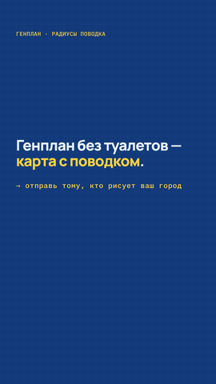 | 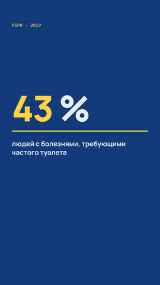 | 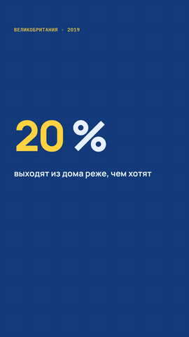 | 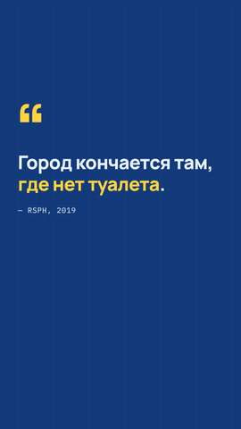 | 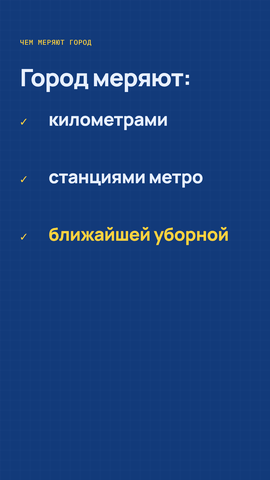 |
| **fraction** | **bars** | **compare** | **timeline** | **map** |
| 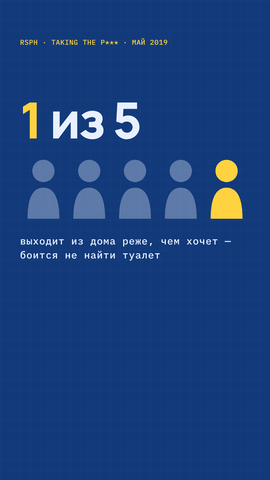 | 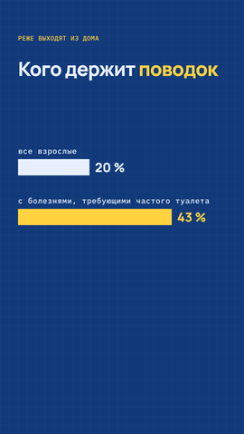 | 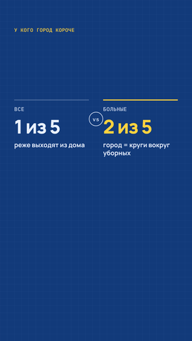 | 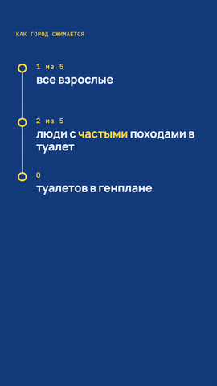 | 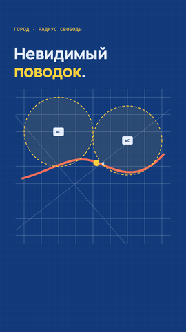 |

<details><summary>Все шаблоны в движении (GIF)</summary>

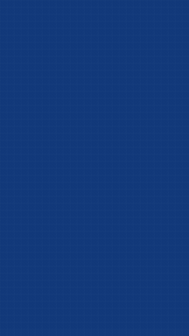

</details>

## Темы

`theme:` в reel.yaml — имя (`blueprint`, `night`, `paper`, `mono`, `poster`, `poster-cream`, `poster-night`, `poster-black`) или словарь с заменой отдельных цветов:
`theme: {base: night, accent: "#00e0a4"}`.


## Свободная сцена `custom`

Когда шаблонов мало: свой HTML/CSS/JS строкой или файлами проекта (`html_file`, `css_file`, `js_file`). JS
выполняется с переменными `S` (селектор сцены), `t` (начало блока) и `tl` (общий таймлайн GSAP); в CSS `{S}`
заменяется селектором сцены. Ошибка в JS одной сцены не ломает остальной ролик: каждая сцена изолирована, а JS с
синтаксической ошибкой отключается на сборке с предупреждением. Пример — `examples/povodok/scenes/`.

## Каталог

### bars

Горизонтальные столбики: растут по очереди, у конца — значение. Акцентный столбик выделен цветом.

Параметры:
- `items` — список {label, value, accent: bool, text: подпись значения вместо числа}; 2…6 штук. Обязательно
- `unit` — единица после числа («%», « км»); необязательно
- `max` — значение во всю ширину; по умолчанию наибольшее из items
- `title` — строка заголовка над столбиками; необязательно
- `kicker` — надзаголовок; необязательно
- `at` — якорь начала роста (дальше шаг 0.2 с) или список якорей по столбикам; по умолчанию 0.4 с

Пример:
```yaml
scene:
  type: bars
  kicker: реже выходят из дома
  title: Кого держит *поводок*
  items:
  - label: все взрослые
    value: 20
  - label: с болезнями, требующими частого туалета
    value: 43
    accent: true
  unit: ' %'
  at:
  - каждый пятый
  - двоих из пяти
```

### compare

Сравнение двух значений колонками с разделителем «vs»; акцентная сторона выделена.

Параметры:
- `left` — {label, value, note} — левая колонка. Обязательно
- `right` — {label, value, note} — правая колонка. Обязательно
- `accent` — left | right | none — какую сторону выделить; по умолчанию right
- `title` — строка заголовка; необязательно
- `kicker` — надзаголовок; необязательно
- `at` — якорь левой колонки; по умолчанию 0.3 с
- `right_at` — якорь правой колонки; по умолчанию at + 0.8 с

Пример:
```yaml
scene:
  type: compare
  kicker: у кого город короче
  left:
    label: все
    value: 1 из 5
    note: реже выходят из дома
  right:
    label: больные
    value: 2 из 5
    note: город = круги вокруг уборных
  at: каждый пятый
  right_at: двоих из пяти
```

### counter

Число, которое «набегает» от from до to (счётчик), с подписью.

Параметры:
- `to` — конечное значение. Обязательно
- `from` — начальное значение; по умолчанию 0
- `prefix` — текст перед числом («≈», «$»); необязательно
- `suffix` — текст после числа («%», « км»); необязательно
- `decimals` — знаков после запятой; по умолчанию 0
- `label` — подпись под числом; необязательно
- `kicker` — надзаголовок; необязательно
- `at` — якорь старта счёта; по умолчанию 0.3 с
- `duration` — длительность счёта, с; по умолчанию 1.4

Пример:
```yaml
scene:
  type: counter
  kicker: Великобритания · 2019
  from: 0
  to: 20
  suffix: ' %'
  label: выходят из дома реже, чем хотят
  at: каждый пятый
```

### cover

Титульная карточка-плакат: крупные наклейки названия, строка пояснения без ярлыка, бирка, второе название и мелкие бирки-теги снизу; всё впечатывается по очереди, стопка повёрнута на −5°.

Параметры:
- `title` — крупные строки названия (список или строка с \n); *слово* — акцентом. Обязательно
- `sub` — пояснение под названием: белый капслок без ярлыка (строка с \n или список); необязательно
- `label` — маленькая тёмная бирка перед вторым названием («воркшоп»); необязательно
- `title2` — второе название (строки), крупно; необязательно
- `tags` — мелкие тёмные бирки в конце (список строк, «теневая архитектура»); необязательно
- `at` — якорь первой строки; по умолчанию 0.3 с
- `sub_at` — якорь пояснения; по умолчанию после названия
- `title2_at` — якорь второго названия; по умолчанию после бирки
- `tags_at` — якорь бирок; по умолчанию после второго названия
- `accent` — сколько последних строк title2 сделать акцентными (style accent); по умолчанию 0
- `tilt` — наклон, градусы; по умолчанию −5
- `position` — top | center | bottom | y в px; по умолчанию center
- `kicker` — надзаголовок; необязательно

Пример:
```yaml
scene:
  type: cover
  title:
  - Открытый
  - город
  - '2026'
  sub: 'Фестиваль архитектурного

    образования и карьеры'
  label: воркшоп
  title2:
  - Ассинтезия
  - города
  tags:
  - теневая архитектура
  at: открытый город
  title2_at: ассинтезия
  tags_at: теневая
```

### custom

Свободная сцена: свой HTML/CSS/JS (строкой или файлами проекта). Для сложной графики, когда шаблонов мало.

Параметры:
- `html` — HTML внутрь сцены (или html_file — путь от папки проекта)
- `css` — CSS (или css_file); токен {S} заменяется на селектор сцены, начинайте каждое правило с {S}
- `js` — JS (или js_file): выполняется с S (селектор сцены), t (начало блока) и tl (общий таймлайн); только tl.fromTo/tl.set с явным начальным состоянием и позициями t + секунды

Пример:
```yaml
scene:
  type: custom
  html: <div class="big hi"><span>Свой <em>код</em></span></div>
  css: '{S} .hi{top:600px}'
  js: tl.fromTo(S+" .hi span",{yPercent:110},{yPercent:0,duration:.45,ease:"expo.out"},t+.3);
```

### fraction

Доля иконками: total фигурок (человечки, точки, квадраты), highlight из них подсвечиваются акцентом; сверху крупная доля, снизу подпись.

Параметры:
- `total` — сколько фигурок, 2…100. Обязательно
- `highlight` — сколько подсветить. Обязательно
- `icon` — person | dot | square; по умолчанию person (для total > 20 — dot)
- `side` — какие подсветить: end (последние) | start (первые); по умолчанию end
- `value` — крупный текст над иконками («*1* из 5»); по умолчанию «highlight из total»
- `label` — подпись под иконками; необязательно
- `kicker` — надзаголовок; необязательно
- `at` — якорь подсветки и появления value; по умолчанию 40%
- `intro` — якорь появления фигурок; по умолчанию 0.3 с

Пример:
```yaml
scene:
  type: fraction
  kicker: RSPH · Taking the P*** · май 2019
  total: 5
  highlight: 1
  value: '*1* из 5'
  label: 'выходит из дома реже, чем хочет —

    боится не найти туалет'
  at: каждый пятый
```

### headline

Крупный заголовок в 1–3 строки с надзаголовком; строки выезжают снизу по якорям. Можно добавить подпись и призыв.

Параметры:
- `lines` — список строк (1–3) или строка с \n; *слово* — акцентом. Обязательно
- `kicker` — надзаголовок (моно, капслок); необязательно
- `at` — якорь первой строки или список якорей по строкам; по умолчанию 0.3 с и шаг 0.45 с
- `sub` — мелкая подпись под заголовком (моно); необязательно
- `sub_at` — якорь подписи; по умолчанию после последней строки
- `cta` — призыв в конце (моно, акцент, со стрелкой →); необязательно
- `cta_at` — якорь призыва; по умолчанию «70%»
- `cta_always` — показывать призыв, даже если блок не последний в монтаже (по умолчанию — только в последнем)
- `top` — верх заголовка, px; по умолчанию — по центру зоны 260…1450
- `size` — наибольший кегль, px; по умолчанию 112 (длинные строки уменьшаются сами)

Пример:
```yaml
scene:
  type: headline
  kicker: генплан · радиусы поводка
  lines:
  - Генплан без туалетов —
  - '*карта с поводком*.'
  at:
  - генплан
  - карта с поводком
  cta: отправь тому, кто рисует ваш город
  cta_at: отправь
```

### illustration

Плоская плакатная иллюстрация из пропов (луна, силуэт города, дома, фонарь, кабинка, человек…): слои с положением, появлением и действиями пропов по якорям диктора, лёгкое покачивание и медленный наезд камеры. Можно во весь кадр; главное держите в зоне y 160…1450.

Параметры:
- `layers` — список слоёв (до 24) {prop, x, y, w, z, flip, rotate, anchor, params, enter, at, actions, float, parallax}. prop — имя пропа (см. PROPS). x, y — точка привязки в px кадра 1080×1920 (по умолчанию низ-центр пропа: anchor bottom; ещё center, top). w — ширина в px (высота по пропорциям пропа). shadow: true или {length 0…1.5, skew градусы, opacity} — длинная тень (ночь, фонарь). z — порядок (фон moon/sun/stars 0, skyline/cloud 1, ground 2, прочее 10+номер). flip — зеркально. rotate — наклон в градусах (плакатный «развал» домов: −4…4). params — параметры пропа. enter — pop|rise|drop|slide-left|slide-right|fade|none (по умолчанию rise), at — якорь появления (по умолчанию лесенкой от начала блока). actions — [{do: действие пропа, at: якорь}] (rise, lights, glow, open…). float: true — лёгкое покачивание. parallax 0…1 — медленный дрейф влево
- `bg` — фон сцены: переменная темы (bg, deep, ink, accent, alt) или цвет «#cc1418»; по умолчанию bg
- `ground` — полоса земли {color, height (px, по умолчанию 380), edge: flat|rough, at}; необязательно
- `grain` — зерно поверх всего кадра 0…1, по умолчанию 0.5 (0 — выключить)
- `camera` — медленный наезд {zoom: [от, до], at, duration, origin: [x, y]}; по умолчанию без наезда

Пример:
```yaml
scene:
  type: illustration
  bg: '#cc1418'
  ground:
    color: '#1d1c1c'
    height: 540
    at: 0
  camera:
    zoom:
    - 1
    - 1.05
    at: 0
  layers:
  - prop: moon
    x: 560
    y: 1130
    w: 720
    enter: fade
    at: 0
    parallax: 0.3
  - prop: skyline
    x: 540
    y: 1400
    w: 1080
    params:
      color: '#8e0d10'
    enter: none
    actions:
    - do: rise
      at: 0.1
  - prop: panel-block
    x: 190
    y: 1480
    w: 330
    rotate: -3
    at: панельки
  - prop: building-classic
    x: 540
    y: 1455
    w: 360
    rotate: 1
    at: классика
  - prop: building-brick
    x: 880
    y: 1490
    w: 320
    rotate: 4
    at: кирпич
    actions:
    - do: lights
      at: вечер
```

### image

Картинка (png/jpg/webp/svg): на весь кадр или в рамке (карточка, телефон, ноутбук); медленный наезд или Ken Burns; сверху 1–2 строки-стикера.

Параметры:
- `src` — путь к картинке от папки проекта. Обязательно
- `frame` — none (по умолчанию) | card (белая карточка с тенью) | phone | laptop
- `fit` — cover (по умолчанию: заполнить, обрезая края) | contain (вписать целиком)
- `x, y, w, h` — положение и размер картинки в кадре, px; без w при frame none — на весь кадр 1080×1920, иначе ширина 920 по центру, высота — по пропорциям картинки
- `zoom` — медленный наезд за время блока: [1, 1.15] (масштаб в начале и в конце)
- `kenburns` — наезд с панорамой: {from: [масштаб, x%, y%], to: [масштаб, x%, y%]} — точка картинки (в %) в центре кадра; вместо zoom
- `enter` — появление: fade (по умолчанию) | rise | slam | slide | none
- `at` — якорь появления; по умолчанию 0.15 с
- `title` — 1–2 строки-стикера над картинкой; *слово* — инверсией; необязательно
- `title_at` — якорь заголовка или список якорей по строкам
- `kicker` — надзаголовок; необязательно

Пример:
```yaml
scene:
  type: image
  src: docs/media/gallery/stat.png
  frame: card
  title:
  - Так выглядит
  - '*сцена stat*'
  title_at:
  - выглядит
  - сцена
  enter: rise
  at: выглядит
  zoom:
  - 1
  - 1.12
```

### list

Список из 2–5 пунктов: появляются по одному (номера 01, 02… или галочки).

Параметры:
- `items` — список строк или {text, at}; *слово* — акцентом. Обязательно
- `style` — number | check | dot; по умолчанию number
- `kicker` — надзаголовок; необязательно
- `title` — строка заголовка над списком; необязательно
- `at` — якорь первого пункта (дальше шаг 0.6 с) или список якорей; у пункта свой at важнее

Пример:
```yaml
scene:
  type: list
  kicker: чем меряют город
  title: 'Город меряют:'
  items:
  - text: километрами
    at: километрами
  - text: станциями метро
    at: станциями
  - text: '*ближайшей уборной*'
    at: уборной
  style: check
```

### map

Схема города в стиле чертежа: сетка улиц, точки с подписями, круги радиусов, маршрут; сверху 1–2 строки заголовка.

Параметры:
- `points` — список {x, y, label, accent: bool} в координатах 0…900; короткая подпись (≤4 знака, «WC») — в плашке
- `radius` — радиус кругов вокруг точек (кроме accent) в единицах карты 0…900; необязательно
- `dim` — true — затемнить всё вне кругов (нужен radius); по умолчанию false
- `route` — линия маршрута: SVG-путь d («M40 520 C 220 470, …»); необязательно
- `title` — 1–2 строки заголовка над картой; *слово* — акцентом; необязательно
- `title_at` — якорь заголовка или список якорей по строкам
- `kicker` — надзаголовок; необязательно
- `at` — якорь появления точек; по умолчанию 0.4 с
- `route_at` — якорь прорисовки маршрута; по умолчанию 0.8 с
- `radius_at` — якорь кругов; по умолчанию 50%

Пример:
```yaml
scene:
  type: map
  kicker: город · радиус свободы
  title:
  - Невидимый
  - '*поводок*.'
  title_at:
  - невидимый
  - поводок
  points:
  - x: 250
    y: 250
    label: WC
  - x: 650
    y: 300
    label: WC
  - x: 470
    y: 430
    label: я
    accent: true
  radius: 200
  radius_at: длину
  route: M40 520 C 220 470, 330 380, 450 420 S 700 560, 860 380
```

### quote

Цитата: крупная кавычка, текст проявляется по словам, ниже автор.

Параметры:
- `text` — текст цитаты, *слово* — акцентом. Обязательно
- `author` — автор или источник; необязательно
- `kicker` — надзаголовок; необязательно
- `at` — якорь начала проявления; по умолчанию 0.3 с
- `duration` — за сколько секунд проявится весь текст; по умолчанию по 0.07 с на слово, не больше 2.5

Пример:
```yaml
scene:
  type: quote
  text: Город кончается там, *где нет туалета*.
  author: RSPH, 2019
  at: мы меряем город
```

### screen

Демонстрация интерфейса по скриншоту (можно длинному): карточка с тенью, камера плавно наезжает на части экрана по якорям, курсор-стрелка ходит и кликает (круги от клика), рамки подсветки. Сверху 1–2 строки-стикера.

Параметры:
- `src` — путь к скриншоту от папки проекта (png/jpg/webp/svg). Обязательно
- `frame` — card (по умолчанию) | none | phone | laptop
- `x, y, w, h` — окно экрана в кадре, px; по умолчанию ширина 920 по центру, высота — по пропорциям, но не ниже зоны 1450 (длинный скриншот показывается сверху и прокручивается фокусом)
- `focus` — шаги камеры: [{at, region: [x, y, w, h] в пикселях скриншота, zoom: 1…3 (по умолчанию — вписать region), dur: длительность перехода, с (0.9)}]; region на всю ширину и zoom 1 — прокрутка
- `cursor` — курсор: [{at, x, y, click: true}] — в пикселях скриншота; к точке приходит к моменту at, click — круг от клика
- `highlight` — рамки акцентом: [{at, region: [x, y, w, h], until: якорь исчезновения, dim: true — затемнить остальное}]
- `enter` — появление карточки: rise (по умолчанию) | fade | slam | slide | none
- `at` — якорь появления; по умолчанию 0.15 с
- `title` — 1–2 строки-стикера над экраном; *слово* — инверсией; необязательно
- `title_at` — якорь заголовка или список якорей
- `kicker` — надзаголовок; необязательно

Пример:
```yaml
scene:
  type: screen
  src: app/desktop/screenshot.png
  title:
  - Один клик —
  - '*ролик готов*'
  title_at:
  - клик
  - готов
  h: 860
  focus:
  - at: этапы
    region:
    - 300
    - 120
    - 600
    - 70
    zoom: 1.6
  - at: дубли
    region:
    - 310
    - 190
    - 560
    - 300
    zoom: 1.6
  - at: подтвердить
    region:
    - 320
    - 430
    - 420
    - 70
    zoom: 2.4
  cursor:
  - at: дубли
    x: 1260
    y: 333
  - at: подтвердить
    x: 445
    y: 465
    click: true
  highlight:
  - at: дубли
    region:
    - 326
    - 264
    - 990
    - 46
    until: подтвердить
    dim: true
```

### stat

Одно крупное число или доля («*1* из 5», «43 %») с подписью; число выезжает по якорю, под ним растёт линия.

Параметры:
- `value` — число/текст крупно, *часть* — акцентом. Обязательно
- `label` — подпись под числом (что это за число); необязательно
- `kicker` — надзаголовок; необязательно
- `at` — якорь появления числа; по умолчанию 0.3 с
- `top` — верх числа, px; по умолчанию — по центру зоны
- `size` — наибольший кегль числа, px; по умолчанию 240

Пример:
```yaml
scene:
  type: stat
  kicker: RSPH · 2019
  value: '*43* %'
  label: 'людей с болезнями, требующими

    частого туалета'
  at: двоих из пяти
```

### stickers

Плакатные наклейки: каждая строка — свой ярлык (белый с чёрным текстом капслоком), строки зигзагом, стопка повёрнута на −5°; строки «впечатываются» по очереди. Для тем poster*, работает и в остальных.

Параметры:
- `lines` — строки: список строк или {text, at, style, size, shift}; *слово* — акцентом. Обязательно. style: white (основная) | black (бирка) | accent | outline | plain (без ярлыка); size: L (крупно, капслок) | M | S (мелко, регистр как написан); shift: сдвиг вправо, px
- `at` — якорь первой строки; дальше каждая +0.18 с (у строки свой at важнее); по умолчанию 0.3 с
- `step` — шаг между строками без своего at, с; по умолчанию 0.18
- `tilt` — наклон стопки, градусы; по умолчанию −5
- `position` — top | center | bottom | y верха в px; по умолчанию center
- `align` — left | center; по умолчанию left
- `stagger` — zigzag | stairs | none — сдвиг строк по горизонтали; по умолчанию zigzag
- `slam` — true (по умолчанию) — строки впечатываются; false — проявляются слева направо
- `kicker` — надзаголовок; необязательно

Пример:
```yaml
scene:
  type: stickers
  lines:
  - text: Что прячет
    at: что прячет
  - городская
  - '*кабинка?*'
  - text: тук-тук
    size: S
    style: black
    shift: 420
    at: тук-тук
  position: top
```

### tag

Одна маленькая бирка (чёрный ярлык, белый текст как написан) в точке x, y: выскакивает и может покачаться — «тук-тук», «БАХ», «теневая архитектура» рядом с иллюстрацией.

Параметры:
- `text` — текст бирки; *слово* — акцентом. Обязательно
- `x` — левый край, px; по умолчанию по центру кадра
- `y` — верх, px; по умолчанию 1180
- `tilt` — наклон, градусы; по умолчанию −6
- `style` — black (по умолчанию) | white | accent | outline
- `size` — S (по умолчанию) | M | L
- `at` — якорь появления; по умолчанию 0.3 с
- `anim` — pop (по умолчанию, выскакивает) | slam (впечатывается)
- `wiggle` — покачаться после появления: true (4 раза) или число качаний; по умолчанию нет

Пример:
```yaml
scene:
  type: tag
  text: тук-тук
  x: 640
  y: 1100
  at: тук-тук
  wiggle: true
```

### timeline

Вертикальная шкала времени: линия прорисовывается, вехи появляются по очереди.

Параметры:
- `points` — список {label (год/дата), text, at}; 2…5 штук; *слово* — акцентом. Обязательно
- `kicker` — надзаголовок; необязательно
- `at` — якорь первой вехи (дальше шаг 0.7 с) или список якорей; у вехи свой at важнее

Пример:
```yaml
scene:
  type: timeline
  kicker: как город сжимается
  points:
  - label: 1 из 5
    text: все взрослые
    at: каждый пятый
  - label: 2 из 5
    text: люди с *частыми* походами в туалет
    at: двоих из пяти
  - label: '0'
    text: туалетов в генплане
    at: генплан
```

### video

Видеоклип или запись экрана (mp4/webm) в рамке или на весь кадр; играет с начала блока (кадра), без звука (по умолчанию), можно ускорить. Сверху 1–2 строки-стикера.

Параметры:
- `src` — путь к видео от папки проекта (mp4/webm/mov). Обязательно
- `frame` — card (по умолчанию) | none | phone | laptop
- `fit` — cover (по умолчанию) | contain
- `x, y, w, h` — положение и размер в кадре, px; без w при frame none — на весь кадр; иначе ширина 920 по центру, высота по пропорциям видео
- `media_start` — с какой секунды файла начинать; по умолчанию 0
- `speed` — скорость 0.1…10; по умолчанию 1
- `muted` — true (по умолчанию) — без звука ролика; false — звук клипа идёт в микс
- `volume` — громкость звука клипа при muted: false; по умолчанию 0.5
- `enter` — появление: fade (по умолчанию) | rise | slam | slide | none
- `at` — якорь появления рамки; по умолчанию 0.15 с (видео играет с начала блока)
- `title` — 1–2 строки-стикера над видео; *слово* — инверсией; необязательно
- `title_at` — якорь заголовка или список якорей
- `kicker` — надзаголовок; необязательно

Пример:
```yaml
scene:
  type: video
  src: local-model-test/results/qwen3-vl-8b/reel-fixed.mp4
  frame: phone
  w: 520
  media_start: 1
  speed: 1.5
  title:
  - Готовый ролик
  - '*за один прогон*'
  title_at:
  - готовый
  - прогон
  enter: slam
  at: готовый
```
